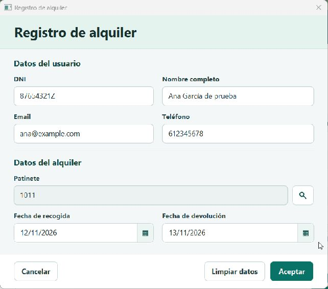
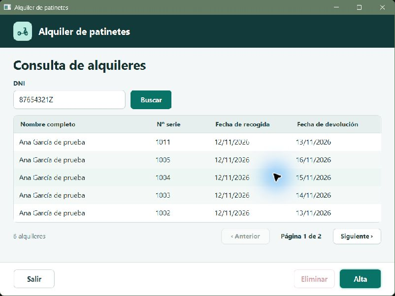

# Alquiler de patinetes · Java y MySQL

Aplicación académica de escritorio para registrar, consultar y eliminar alquileres de patinetes. Usa Java 21, JavaFX, JDBC y MySQL.

## Contexto y alcance

Proyecto académico de Desarrollo de Aplicaciones Multiplataforma. La implementación inicial y la preparación de la documentación se realizaron con asistencia de IA.

## Funciones implementadas

- Formulario de alta con validación de DNI, nombre, correo, teléfono y fechas.
- Selección de patinete desde un catálogo de 50 registros de demostración, con diez elementos por página.
- Consulta por DNI con cinco alquileres por página.
- Eliminación con confirmación y actualización de la consulta.
- Acceso a datos mediante consultas parametrizadas y transacciones JDBC.
- Separación de modelos, controladores, vistas FXML y acceso a datos.

## Requisitos

- JDK 21 o posterior.
- Maven.
- MySQL 8.0 o posterior.

## Preparar la base de datos

En una base de desarrollo, abre `database/alquilerpatin.sql` en MySQL Workbench y ejecuta el script con una cuenta autorizada para crear el esquema y las tablas. Crea `ALQUILERPATIN` y las tablas `Usuarios`, `Patinetes` y `Registro`, y carga los patinetes de ejemplo.

El script también contiene migraciones para esquemas anteriores de la actividad. Utiliza una instalación de prueba, separada de datos reales. El repositorio no incluye un volcado de usuarios ni alquileres.

La aplicación lee estas variables de entorno:

| Variable | Uso |
| --- | --- |
| `ALQUILERPATIN_DB_URL` | URL JDBC del esquema; por defecto `jdbc:mysql://localhost:3306/ALQUILERPATIN`. |
| `ALQUILERPATIN_DB_USER` | Usuario MySQL de desarrollo. |
| `ALQUILERPATIN_DB_PASSWORD` | Contraseña del usuario, definida solo en tu equipo. |

Configúralas en el entorno de la terminal o en la configuración de ejecución de tu IDE. La cuenta necesita leer las tres tablas, insertar y actualizar `Usuarios`, e insertar y eliminar registros de alquiler.

## Ejecutar

Desde la raíz del repositorio, con las variables configuradas:

```sh
mvn compile javafx:run
```

También puedes importar el proyecto en Eclipse mediante **File → Import → Maven → Existing Maven Projects** y ejecutar los objetivos `compile javafx:run` con un JDK 21 o posterior.

## Recorrido de comprobación manual

1. Abre **Alta** e introduce datos ficticios: un DNI con ocho cifras y letra, nombre de prueba, correo de `example.com` y teléfono de prueba.
2. Selecciona un patinete con la lupa. La recogida debe ser hoy o posterior y la devolución igual o posterior a la recogida.
3. Guarda el alquiler y comprueba que aparece en la consulta del DNI.
4. Registra más de cinco alquileres ficticios para comprobar la paginación.
5. Selecciona un alquiler y comprueba tanto cancelar como aceptar su eliminación.
6. Prueba campos vacíos, correo incorrecto, fechas inexistentes y devolución anterior a recogida; el formulario debe rechazar esos datos.

## Capturas

Son capturas guardadas de la actividad con datos ficticios; ilustran una ejecución anterior y no sustituyen una prueba actual en tu instalación.





También se incluyen el catálogo y la confirmación de alta en `docs/capturas/`.

## Estructura

- `src/main/java/alquilerpatin/`: inicio, modelos, controladores y DAO.
- `src/main/resources/alquilerpatin/vistas/`: vistas FXML y estilos.
- `database/alquilerpatin.sql`: estructura y catálogo de demostración.
- `docs/capturas/`: capturas de la aplicación con datos de prueba.

## Verificación y límites

En la preparación de esta publicación se comprobó la compilación de las fuentes con compatibilidad Java 21. No se repitió el recorrido completo contra una instalación MySQL.

Es una aplicación de escritorio académica. La interfaz expone altas, consultas y bajas. Su alcance no incluye API web, autenticación de usuarios ni pagos.
